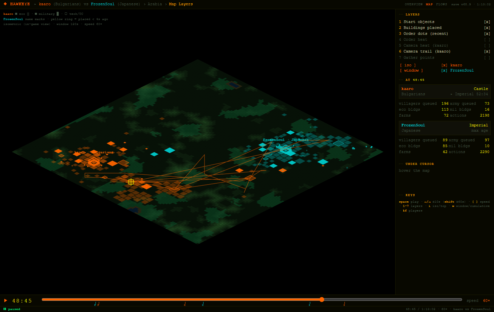
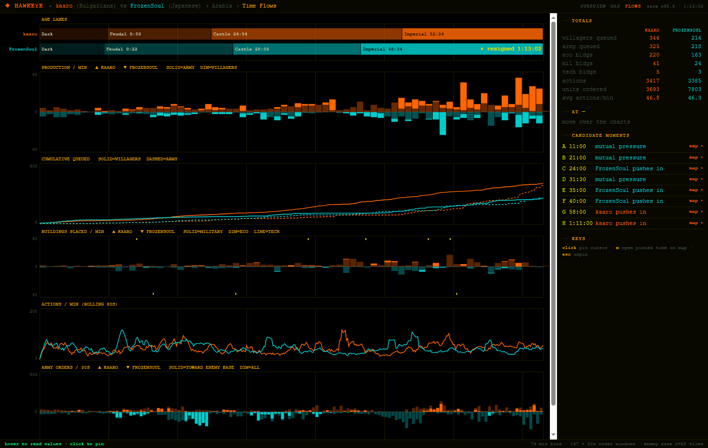

# Hawkeye — AoE2 game review (`aoe2-game-parser`)

A top-down "hawkeye" review of an Age of Empires II: Definitive Edition recorded game, rebuilt from the replay's commands.
First match: **kaaro (Bulgarians) vs FrozenSoul (Japanese)**, Arabia 1v1, 2026-11-20, 73:02, FrozenSoul resigned.




**Live:** https://karx.github.io/aoe2-game-parser/ (after the one-time Pages setting below)

## Open it
Double-click `index.html` (no server needed; data is `data/match.js`), or use the live site.
- `map.html` — Map Layers: isometric/top-down map, time scrubber, layers (start objects, buildings, order dots, order heat, camera heat/trail, gather points). URL hash: `#t=1500&l=oheat,build&v=top&m=cum`.
- `flows.html` — Time Flows: age lanes, production/min, cumulative queues, build rate, APM, army-order pressure, candidate moments.

## Analyse a game
```
venv\Scripts\python tools\analyze.py --list      # newest replays: players, civs, map, duration, save version
venv\Scripts\python tools\analyze.py             # auto-pick the main game, copy, extract, print headline
venv\Scripts\python tools\analyze.py --replay "<file>.aoe2record"
```
Writes `data/match.js` (current) and `data/matches/<slug>.js` (archive). `tools/extract.py` is the extractor,
`tools/probe.py` prints raw header/action counts. The Claude skill `aoe2-hawkeye` (`skill/aoe2-hawkeye/`) drives this.

## Setup (fresh machine)
```
git clone https://github.com/happyleavesaoc/aoc-mgz.git vendor-aoc-mgz
git -C vendor-aoc-mgz checkout <commit in vendor-patches/BASE.txt>
git -C vendor-aoc-mgz apply ../vendor-patches/aoc-mgz-pr147.diff
python -m venv venv && venv\Scripts\pip install .\vendor-aoc-mgz
```
`vendor-aoc-mgz/`, `venv/` and `replays/` are git-ignored; the patch + base commit are tracked.

## Publish / share (GitHub Pages)
One-time: repo **Settings → Pages → Build and deployment → Source: GitHub Actions**.
After that every push to `main` that touches the site files runs `.github/workflows/pages.yml`, which publishes
only `index.html`, `map.html`, `flows.html`, `assets/`, `data/`, `docs/` (not tools, replays, patches or the skill).

New game → live site:
```
venv\Scripts\python tools\analyze.py
git add data && git commit -m "Add match <slug>" && git push
```
Note: the published data includes both players' in-game names. Profile ids are not written.

## Credits
Replay parsing builds on [happyleavesaoc/aoc-mgz](https://github.com/happyleavesaoc/aoc-mgz) (MIT); this repo ships only a patch against it.
Dataset names come from `aocref`. Not affiliated with Microsoft/World's Edge; Age of Empires II is their trademark.

## Parser (important)
Released `mgz` (PyPI 1.8.51) cannot read DE save v67.2+ (these replays are v68.9).
`vendor-aoc-mgz/` is a clone of happyleavesaoc/aoc-mgz with the three edits from the open
PR #147 applied by hand (branch `pr147-local`). Only the **fast** parser works on this
format (header + body); the full header parser still fails on `initial`.

## Data caveats
A replay holds commands, not state: no resources/kills/unit positions/opponent camera.
Time = replay sync clock. Camera = recorder (kaaro) only. "Pressure" = orders landing within
28 tiles of the enemy start (proxy, not proof of a fight). Order heat mixes worker and army orders.
Queued counts are production orders, not units alive.

## Next
Separate army vs worker orders (track unit ids), per-fight zoom, render playback to frames → ffmpeg short.
